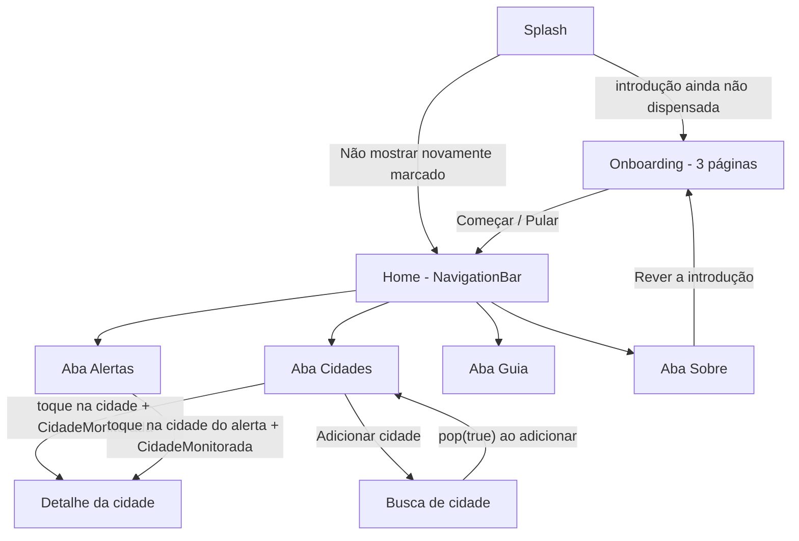
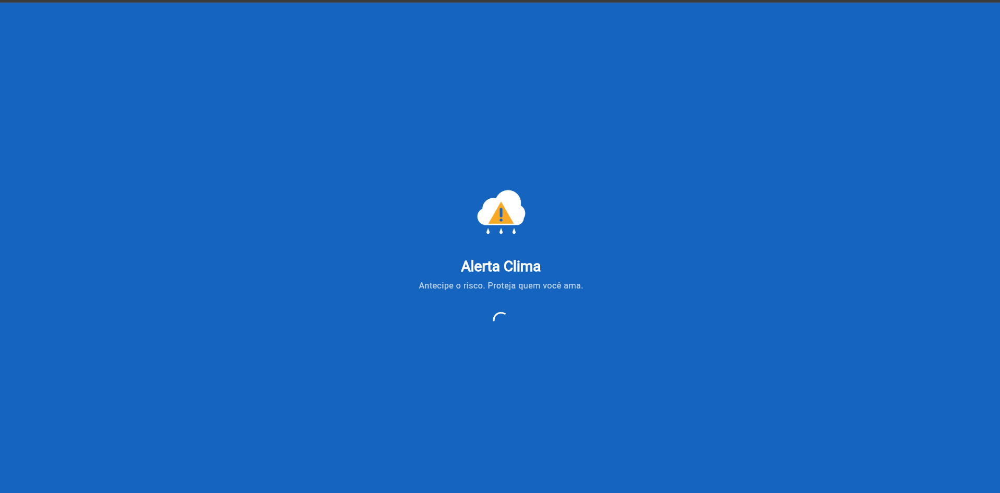
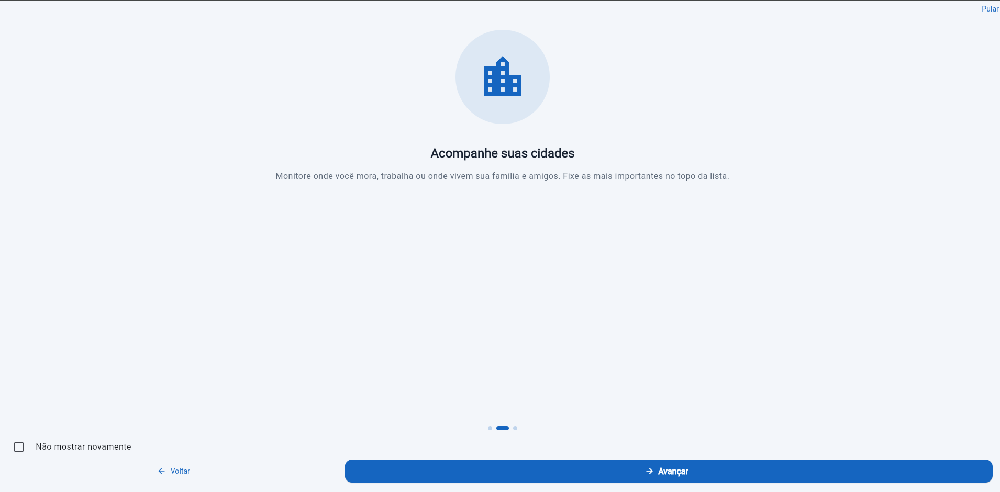
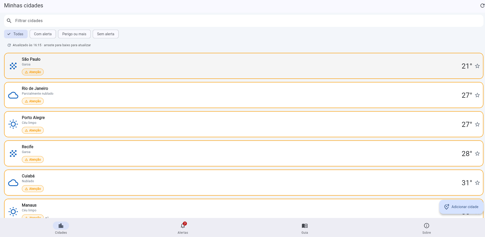
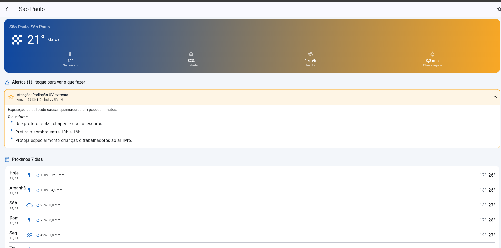
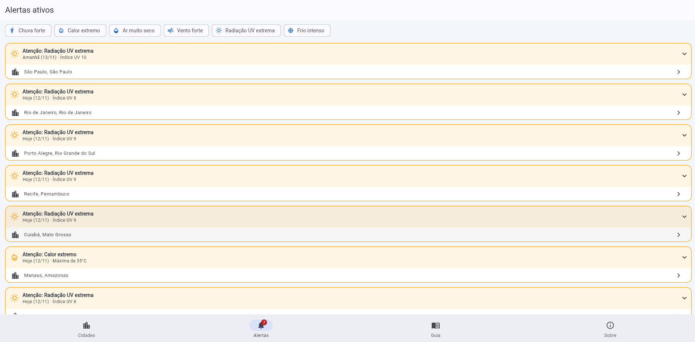
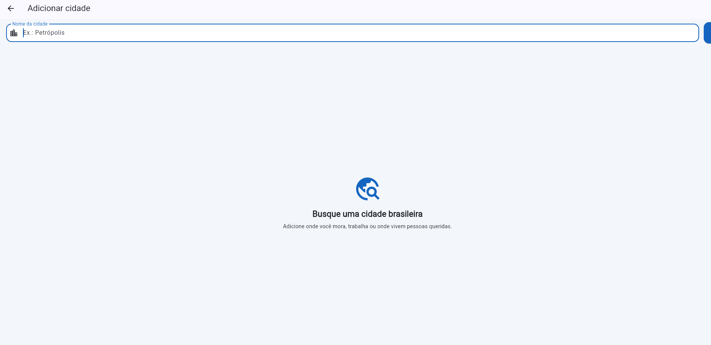
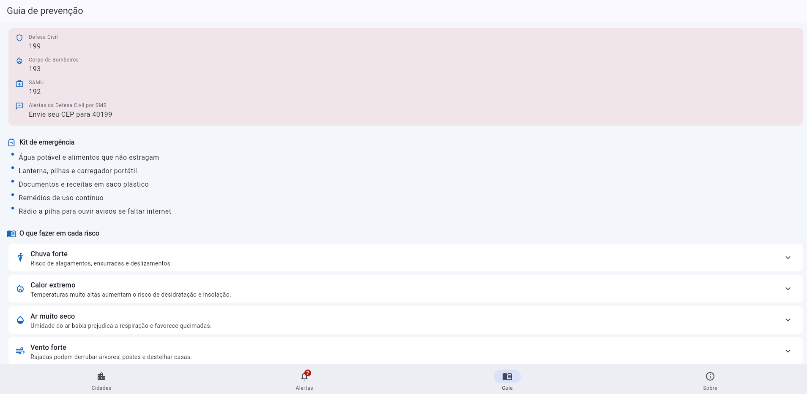
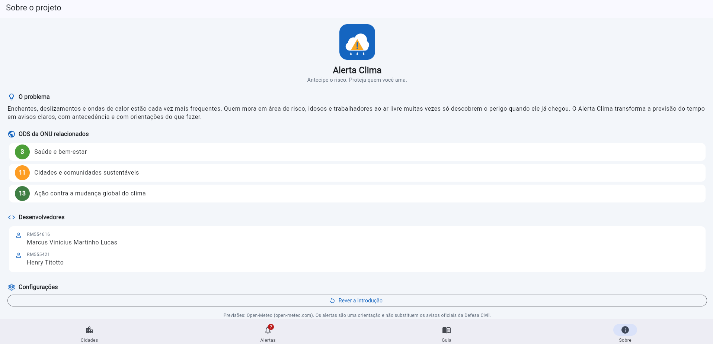

# Alerta Clima ⛈️

> **Antecipe o risco. Proteja quem você ama.**
> Aplicativo Flutter de alertas de chuva forte, calor extremo e outros riscos climáticos, desenvolvido para a **Global Solution 2026.2 – CitizenTech** (FIAP).

---

## 👥 Desenvolvedores

| RM | Nome completo |
|----|---------------|
| RM554616 | _Marcus Vinicius Martinho Lucas_ |
| RM555421 | _Henry Titotto_ |


---

## 💡 Descrição da solução

Enchentes, deslizamentos e ondas de calor estão cada vez mais frequentes no Brasil. Quem mora em área de risco, idosos, crianças e trabalhadores ao ar livre muitas vezes só descobre o perigo quando ele já chegou, e a previsão do tempo comum (só números) não diz **qual é o risco** nem **o que fazer**.

O **Alerta Clima** transforma a previsão do tempo em avisos claros:

- **Monitoramento de várias cidades** (onde a pessoa mora, trabalha ou onde vivem familiares), com temperatura atual e nível de risco de cada uma.
- **Alertas com até 3 dias de antecedência** para 6 riscos: chuva forte, calor extremo, ar muito seco, vento forte, radiação UV extrema e frio intenso.
- **Três níveis de gravidade** (Atenção, Perigo e Grande perigo), em amarelo, laranja e vermelho, no estilo dos avisos meteorológicos oficiais.
- **O que fazer**: cada alerta traz orientações simples de prevenção.
- **Guia de prevenção** com telefones de emergência (Defesa Civil 199, Bombeiros 193, SAMU 192), kit de emergência e cadastro de alertas da Defesa Civil por SMS (40199).
- **Funciona sem internet**: a última previsão fica salva no aparelho e é exibida com a data/hora em que foi baixada.

### Tema da Global Solution
**CitizenTech**: tecnologias criadas a partir das necessidades reais das pessoas. O app segue a sugestão do briefing de *"sistemas de previsão de enchentes, deslizamentos, incêndios e ondas de calor com alertas direcionados à população"*.

**ODS relacionados:** ODS 3 (Saúde e bem-estar), ODS 11 (Cidades e comunidades sustentáveis) e ODS 13 (Ação contra a mudança global do clima).

---

## 🗺️ Fluxo de telas



| Tela | Arquivo |
|------|---------|
| Splash | `lib/screens/splash/splash_screen.dart` |
| Onboarding | `lib/screens/onboarding/onboarding_screen.dart` |
| Home (abas) | `lib/screens/home/home_screen.dart` |
| Cidades (lista, busca, filtro, fixar, remover) | `lib/screens/cidades/cidades_screen.dart` |
| Alertas (todas as cidades, filtro por tipo) | `lib/screens/alertas/alertas_screen.dart` |
| Detalhe da cidade (agora, alertas, 7 dias) | `lib/screens/cidade_detalhe/cidade_detalhe_screen.dart` |
| Busca de cidade (API de geocodificação) | `lib/screens/busca_cidade/busca_cidade_screen.dart` |
| Guia de prevenção | `lib/screens/guia/guia_screen.dart` |
| Sobre | `lib/screens/sobre/sobre_screen.dart` |

---

## 📸 Prints das telas

| Splash | Onboarding | Cidades | Detalhe |
|--------|-----------|---------|---------|
|  |  |  |  |

| Alertas | Busca de cidade | Guia | Sobre |
|---------|-----------------|------|-------|
|  |  |  |  |

---

## 🌐 API utilizada

**Open-Meteo** (pública, gratuita, sem chave de acesso). São consumidos 2 endpoints com o pacote **`http`**:

### 1. Previsão do tempo (`lib/services/clima_service.dart`)
```
GET https://api.open-meteo.com/v1/forecast
    ?latitude=-23.5505,-22.9068&longitude=-46.6333,-43.1729
    &current=temperature_2m,relative_humidity_2m,apparent_temperature,precipitation,weather_code,wind_speed_10m
    &daily=weather_code,temperature_2m_max,temperature_2m_min,precipitation_sum,precipitation_probability_max,uv_index_max,wind_speed_10m_max
    &timezone=auto,auto&forecast_days=7
```
Todas as cidades vão em **uma única requisição** (coordenadas separadas por vírgula). Com várias cidades a API devolve uma lista; com uma só, um objeto. O serviço trata os dois casos.
O JSON é convertido nos models `PrevisaoClima`, `CondicaoAtual` e `PrevisaoDiaria` (`lib/models/previsao_clima.dart`).

### 2. Busca de cidades (`lib/services/geocoding_service.dart`)
```
GET https://geocoding-api.open-meteo.com/v1/search?name=Petrópolis&count=15&language=pt&countryCode=BR
```
Convertido no model `Cidade` (`Cidade.fromGeocodingJson`).

### Estados tratados (enum `ViewState`)
| Estado | Cidades | Busca de cidade |
|--------|---------|-----------------|
| **Inicial** | antes do primeiro carregamento | instrução para digitar o nome |
| **Carregando** | indicador + texto | indicador + texto |
| **Sucesso** | lista com nível de risco | lista de resultados |
| **Erro** | mensagem amigável + **Tentar novamente** | mensagem amigável + **Tentar novamente** |

Erros tratados: código HTTP diferente de 200, tempo esgotado, sem internet e resposta inválida. Sem internet, se houver previsão salva, o app mostra os dados salvos com o aviso *"Sem internet. Mostrando a previsão salva em…"*.

---

## 🏛️ Arquitetura

Separação em camadas, com gerenciamento de estado por **`setState`** e regras de negócio fora dos widgets:

```
lib/
├── main.dart / app.dart          # Inicialização e MaterialApp (tema + rotas)
├── core/
│   ├── constants/                # Cores, cidades padrão, desenvolvedores
│   ├── routes/app_routes.dart    # Rotas nomeadas + passagem de parâmetros
│   └── utils/                    # Formatação e tradução do código do tempo (WMO)
├── models/                       # Cidade, PrevisaoClima, Alerta, NivelAlerta, TipoAlerta...
├── services/                     # ClimaService e GeocodingService (http),
│                                 # PreferencesService (SharedPreferences),
│                                 # AnaliseRiscoService (regras dos alertas)
├── repositories/                 # CidadeRepository (lista/favoritas) e
│                                 # ClimaRepository (API + cache para uso offline)
├── controllers/                  # Estado e lógica das telas (busca, filtros, carregamento)
├── screens/                      # Telas (StatefulWidget / StatelessWidget)
└── widgets/                      # Widgets reutilizáveis
```

**Fluxo de dados:** `Screen` → `Controller` → `Repository` → `Service` (API / SharedPreferences). O controller guarda o estado (`ViewState`, listas, filtros) e a tela chama `setState` para redesenhar.

### Regras dos alertas (`AnaliseRiscoService`)
Analisa a condição atual e os próximos 3 dias e mantém, para cada tipo de risco, o dia mais crítico.

| Risco | Atenção | Perigo | Grande perigo |
|-------|---------|--------|---------------|
| Chuva no dia | ≥ 30 mm | ≥ 50 mm | ≥ 100 mm |
| Temperatura máxima | ≥ 35 °C | ≥ 37 °C | ≥ 40 °C |
| Umidade do ar (agora) | ≤ 30% | ≤ 20% | ≤ 12% |
| Vento máximo | ≥ 40 km/h | ≥ 60 km/h | ≥ 90 km/h |
| Índice UV | ≥ 8 | ≥ 11 | ≥ 14 |
| Temperatura mínima | ≤ 8 °C | ≤ 3 °C | ≤ 0 °C |

Os limites são de referência para o protótipo e ficam concentrados num único arquivo para facilitar ajustes.

### Widgets reutilizáveis criados
`AppLogo`, `BotaoPrincipal`, `CidadeCard`, `AlertaCard` (usado no Detalhe e na aba Alertas), `NivelBadge`, `PrevisaoDiaTile`, `DadoClima`, `EstadoMensagem` (inicial, vazio e erro), `EstadoCarregando`, `SecaoTitulo`, `ListaTopicos`, `InfoLinha`, `IndicadorPagina`, `OnboardingPagina`.

### Persistência local (SharedPreferences)
- Preferência **"Não mostrar novamente"** da introdução.
- **Cidades monitoradas** (lista em JSON).
- **Cidades fixadas** no topo.
- **Cache da última previsão** de cada cidade + data/hora, para uso sem internet.

---

## ✅ Requisitos da avaliação × implementação

| Requisito | Onde está |
|-----------|-----------|
| 1. Splash com logo, transição automática e verificação no SharedPreferences | `SplashScreen` + `PreferencesService.deveExibirOnboarding()` |
| 2. Onboarding (3 páginas, ícone, título, descrição, Voltar/Avançar, "Não mostrar novamente") | `OnboardingScreen`, `OnboardingPagina`, `IndicadorPagina` |
| 3. Navegação (7 telas além de Splash/Onboarding, parâmetros, retorno) | `AppRoutes` (`CidadeMonitorada` como argumento; a busca devolve `true` no `pop`), `NavigationBar` |
| 4. WebService com `http`, models, 4 estados e "tentar novamente" | `ClimaService`, `GeocodingService`, `CidadesScreen`, `BuscaCidadeScreen` |
| 5. Column, Row, Card, ListView, Scaffold, AppBar, botões, Icon/IconButton, Image.asset | Todas as telas; `Image.asset` em `AppLogo` |
| 6. Interações | Cidade → detalhe; busca por nome; filtro por risco; filtro por tipo de alerta; fixar cidade; deslizar para remover (com desfazer); adicionar cidade; puxar para atualizar; expandir alerta |
| 7. Organização, setState e separação de responsabilidades | Camadas `models / services / repositories / controllers / screens / widgets` |

---

## ▶️ Como executar

Pré-requisito: Flutter 3.24 ou superior.

```bash
# 1. Gerar as pastas de plataforma (android/ios) sem sobrescrever o código
flutter create . --org br.com.fiap --project-name alerta_clima --platforms android,ios

# 2. Baixar dependências
flutter pub get

# 3. Rodar
flutter run

# Testes unitários
flutter test
```

> O `AndroidManifest.xml` principal já inclui a permissão `INTERNET`, necessária para a API funcionar no APK de release.

---

> ⚠️ Os alertas do app são uma orientação baseada em previsão do tempo e **não substituem os avisos oficiais da Defesa Civil**. Em emergência, ligue 199 (Defesa Civil) ou 193 (Bombeiros).
